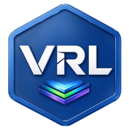
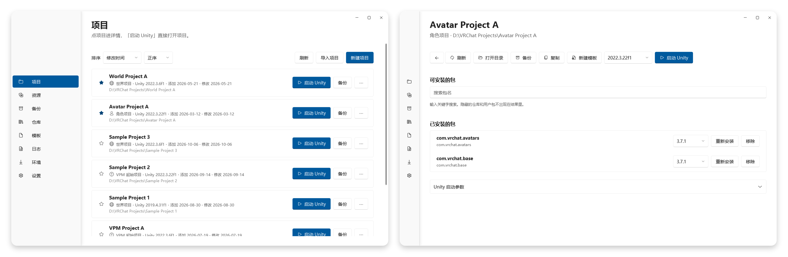

<div align="center">
  
  <h1>VRCLearn Launcher</h1>
  <p>Windows 上的 VRChat 包与项目管理器，基于 .NET 8 与 WPF 构建。</p>

  [下载](https://github.com/VRLearn-Official/VRCLearn_Launcher/releases) · [English](README.md) · [问题反馈](https://github.com/VRLearn-Official/VRCLearn_Launcher/issues)
</div>

<p align="center">
  <a href="https://github.com/VRLearn-Official/VRCLearn_Launcher/actions/workflows/build.yml"></a>
  <a href="https://github.com/VRLearn-Official/VRCLearn_Launcher/releases"></a>
  
  <a href="LICENSE"></a>
</p>

VRCLearn Launcher 把 VPM 仓库、包与 Unity 项目集中在一处管理。本项目为独立实现，与 VRChat Inc.、Unity Technologies 无隶属关系。

## 截图

<p align="center">
  
</p>

## 功能

- **仓库**：管理 VPM 仓库，搜索、安装与升级包，自动处理依赖
- **项目**：列表、新建、收藏、归档；按所选 Unity 版本启动；备份与还原
- **资源**：管理本地 unitypackage，支持封面、标签、搜索与说明书
- **启动器备份**：仅配置或全量备份，可还原到指定目录
- **模板**：导入与创建 `.vrclearn-template` 项目
- **工具**：环境检测、Unity Hub / 编辑器下载、可选关闭 Unity Hub 自动更新
- **桌面集成**：`vcc://` 深链与文件关联
- **检查更新**：启动时读取 `version.txt`，有新版本时打开下载页
- **本地化**：简体中文与英文，支持自定义

## 安装

从 [Releases](https://github.com/VRLearn-Official/VRCLearn_Launcher/releases) 下载 `VRCLearnLauncher-win-x64-Setup.exe` 并运行。

- Windows 10 或更高版本，x64
- 安装包已内置 .NET 8 桌面运行时，无需单独安装

安装包暂未签名，首次运行时 Windows SmartScreen 可能提示；选择「更多信息」→「仍要运行」。

## 构建

环境要求：

- Windows 10 或更高版本，x64
- [.NET 8 SDK](https://dotnet.microsoft.com/download/dotnet/8.0)

还原并构建应用项目：

```
dotnet restore src/VRCLearn.App/VRCLearn.App.csproj
dotnet build src/VRCLearn.App/VRCLearn.App.csproj -c Release
```

从源码运行：

```
dotnet run --project src/VRCLearn.App/VRCLearn.App.csproj
```

目标框架为 `net8.0-windows`，运行时标识为 `win-x64`。发布产物为自包含模式，已内置 .NET 8 运行时，安装后不再需要单独安装运行时。

GitHub Actions 会在每次推送到 `main` 以及打 `v*` 标签时构建安装包，Setup 可执行文件作为每次运行的 artifact 提供下载。推送 `v*` 标签时还会创建草稿 GitHub Release，附上 Setup 安装包和 SHA256 校验文件。

## 项目结构

| 路径 | 内容 |
|---|---|
| `src/VRCLearn.App` | WPF 界面、视图模型、本地化、主题 |
| `src/VRCLearn.Core` | 与平台无关的逻辑，只依赖 BCL |
| `src/VRCLearn.Infrastructure` | Windows API、文件系统、HTTP、存储 |

依赖方向：`App` → `Infrastructure` → `Core`。

## 数据目录

默认与 VRChat Creator Companion 共用 `%LocalAppData%\VRChatCreatorCompanion`；启动器自己的数据位于其下的 `vrclearn\`。

## 许可

[MIT](LICENSE)。第三方组件见 [THIRD-PARTY-NOTICES.txt](THIRD-PARTY-NOTICES.txt)。

## Star History

<a href="https://www.star-history.com/?repos=vrlearn-official%2Fvrclearn_launcher&type=date&legend=top-left">
 <picture>
   <source media="(prefers-color-scheme: dark)" srcset="https://api.star-history.com/chart?repos=vrlearn-official/vrclearn_launcher&type=date&theme=dark&legend=top-left" />
   <source media="(prefers-color-scheme: light)" srcset="https://api.star-history.com/chart?repos=vrlearn-official/vrclearn_launcher&type=date&legend=top-left" />
   
 </picture>
</a>
